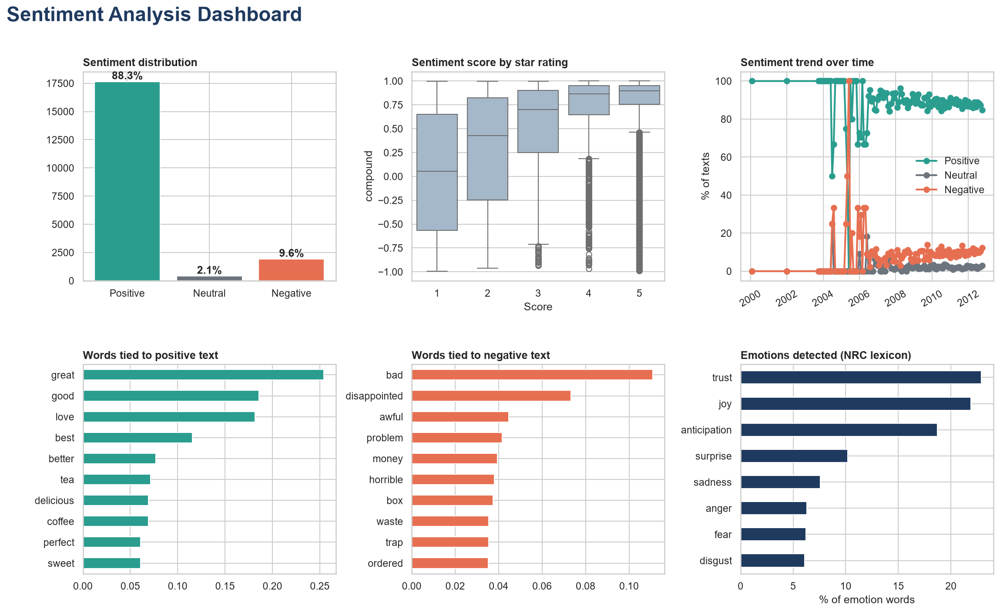

# 💬 Sentiment Analysis: Amazon Fine Food Reviews

> CodeAlpha Data Analytics Internship · Task 4

A Python project that classifies customer reviews as positive, negative or neutral, detects the emotions behind them, and turns the results into insights for marketing and product decisions.



---

## 🎯 Objective

Analyze review text using NLP techniques and lexicons to understand customer opinion, spot patterns in sentiment, and support business decisions.

## 🌐 Data Source

**[Amazon Fine Food Reviews](https://www.kaggle.com/datasets/snap/amazon-fine-food-reviews)** (Kaggle) · 568,454 reviews, from which a random sample of **20,000 reviews** was analysed.

| Column used | Purpose |
|-------------|---------|
| 📝 `Text` | Review text analysed for sentiment and emotion |
| ⭐ `Score` | Star rating (1 to 5), used to check the results |
| 🕒 `Time` | Review date (Unix timestamp), used for the trend chart |

> 📌 The full dataset (about 300 MB) is not included in this repository. Download it from Kaggle and save it as `Reviews.csv` in the project folder.

## 🛠️ Tech Stack

| Tool | Purpose |
|------|---------|
| 🐍 Python 3 | Core language |
| 🐼 Pandas / 🔢 NumPy | Data cleaning and analysis |
| 😀 VADER | Positive / negative / neutral classification |
| 🎭 NRCLex | Emotion detection (joy, trust, anger and more) |
| 🤖 Scikit-learn | Keyword extraction |
| 📉 Matplotlib / 🎨 Seaborn | Visualization |

## ✨ Features

- 😊 **Sentiment classification:** every review labelled positive, neutral or negative with a score from -1 to +1
- 🎭 **Emotion detection:** joy, trust, anticipation, surprise, fear, sadness, disgust and anger
- ⭐ **Rating comparison:** checks how often text sentiment agrees with star ratings
- 🔑 **Keyword analysis:** words most linked to positive and to negative reviews
- 📈 **Trend tracking:** sentiment over time
- 📝 **Auto-generated insights:** findings and recommendations saved to a file

## 📁 Project Structure

```
CodeAlpha_DataAnalytics/
└── 📂 CodeAlpha_Sentiment_Analysis/
    ├── 🐍 sentiment_analysis.py            # Main script
    ├── 📂 sentiment_outputs/
    │   ├── 🖼️ sentiment_dashboard.png      # Dashboard
    │   ├── 🗃️ scored_data.csv              # Every review with its label and score
    │   └── 📝 key_insights.md              # Auto-generated findings
    ├── 📄 KEY_FINDINGS.md                  # Full write-up of results
    └── 📘 README.md
```

## 🚀 How to Run

**1️⃣ Clone the repository**
```bash
git clone https://github.com/sanikadshinde264/CodeAlpha_DataAnalytics.git
cd CodeAlpha_DataAnalytics/CodeAlpha_Sentiment_Analysis
```

**2️⃣ Install dependencies**
```bash
pip install pandas numpy matplotlib seaborn scikit-learn vaderSentiment nrclex
python -m textblob.download_corpora
```

**3️⃣ Add the dataset**
Download `Reviews.csv` from Kaggle (link above) and place it in this folder.

**4️⃣ Run the analysis**
```bash
python sentiment_analysis.py
```

**5️⃣ View your results** 🎉
Open the `sentiment_outputs/` folder.

> 💡 **Tip:** to use a different dataset, edit the `COLS` block at the top of the script.

## 🔍 Key Findings

- 😊 **88.3%** positive · 😐 **2.1%** neutral · 😡 **9.6%** negative
- ⭐ Text sentiment matches star ratings **80%** of the time
- 👎 Negative reviews mention: **bad, disappointed, awful, problem, money**
- 👍 Positive reviews mention: **great, good, love, best, delicious**
- 🎭 Strongest emotions: **trust (23%), joy (22%), anticipation (19%)**
- 📉 Sentiment trend: **stable**, with the positive share moving only +0.6 points between the first and second half of the period

📄 Full details are in [KEY_FINDINGS.md](KEY_FINDINGS.md).

## 💡 Recommendations

- 📦 Look into packaging, shipping and order problems, and check price against value, for products with the most negative reviews
- 📣 Use the themes customers praise (delicious, perfect, sweet) in marketing and product pages
- 📞 Respond quickly to negative reviews to recover unhappy customers
- 🔁 Re-run the analysis regularly to catch changes in sentiment early

## ⚠️ Limitations

- 🤔 Lexicon-based tools can miss sarcasm, slang and context
- ⚖️ Only 2.1% of reviews are neutral, because food reviews are strongly opinionated and VADER's neutral range is narrow
- 🪤 Some keywords come from the product type, not the sentiment (for example "trap" appears in reviews of pest traps)
- 🎲 Results are based on a random sample of 20,000 of the 568,454 reviews
- 🌍 VADER and NRC work best on English text

## 🧠 What I Learned

- 🔤 Cleaning and preparing text data for analysis
- 📚 How lexicon-based sentiment and emotion analysis works
- 🛠️ Fixing library version problems (NRCLex changed its interface between versions)
- 📊 Turning text into numbers and visuals that show customer opinion
- 🎯 Linking sentiment results to business actions

## 🔮 Future Improvements

- 🤖 Compare with a machine learning model (e.g. Naive Bayes or a transformer)
- 🐦 Analyze social media or news data alongside reviews
- 🗂️ Break results down by product category
- 🖥️ Build an interactive web dashboard

## 👩‍💻 Author

**Sanika Deepak Shinde**
🎓 Data Analytics Intern · CodeAlpha

🔗 [LinkedIn](https://www.linkedin.com/in/your-profile) · 💻 [GitHub](https://github.com/sanikadshinde264)

---

⭐ *If you found this project useful, give it a star!*